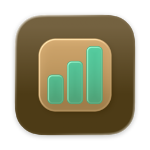
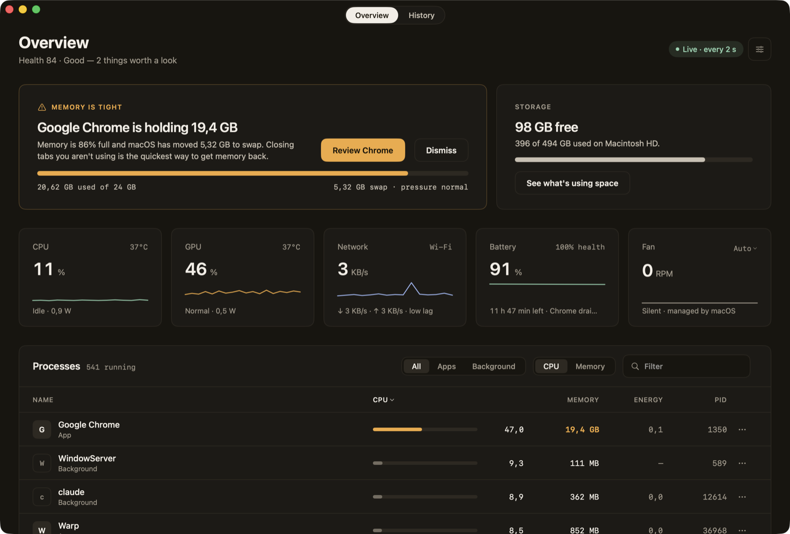
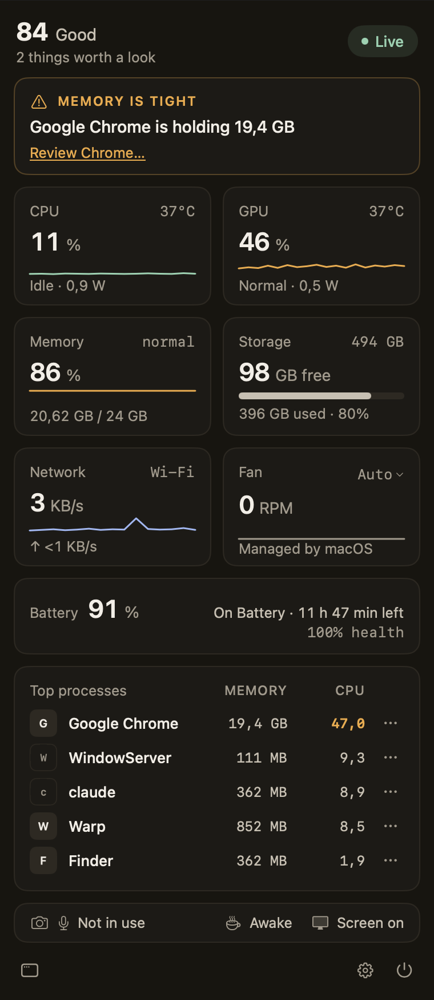
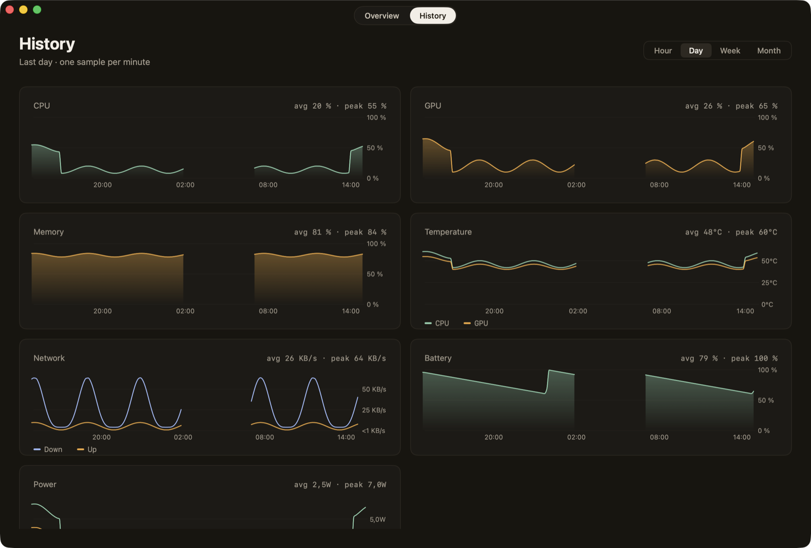
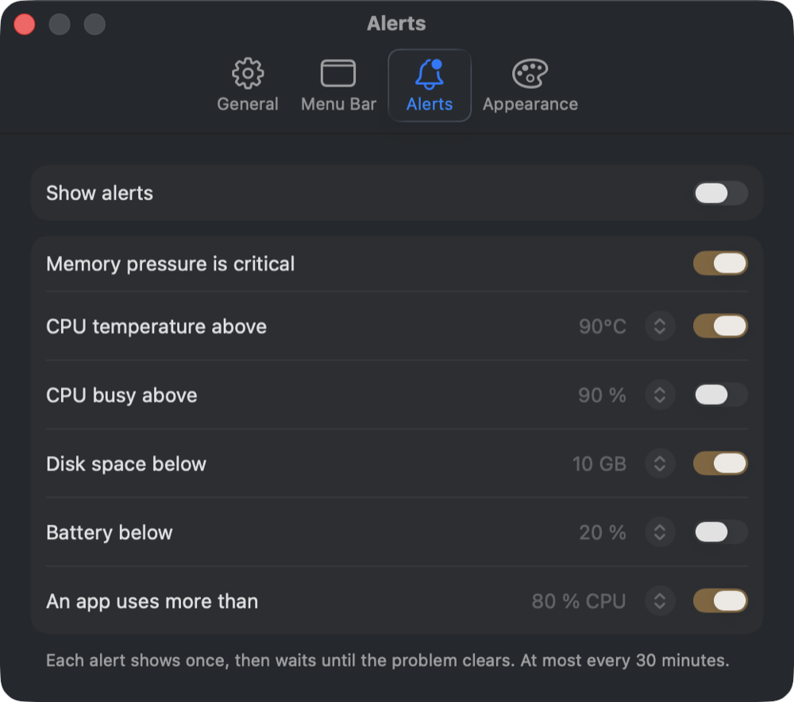
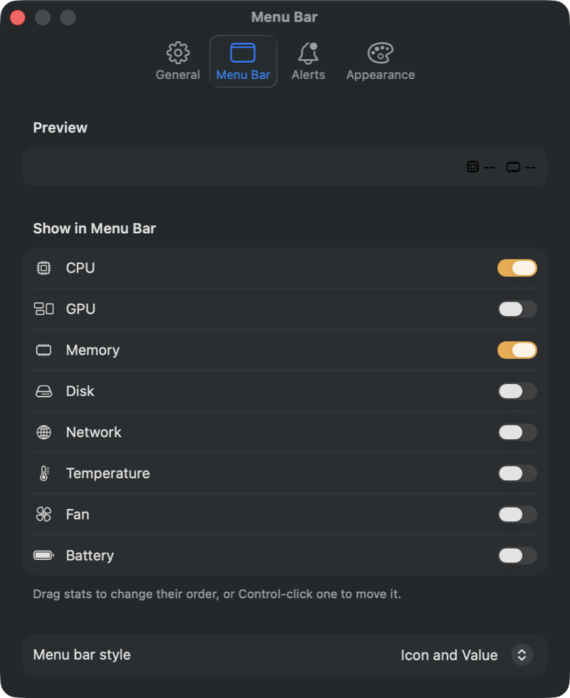

<p align="center">
  
</p>

<h1 align="center">MangoStats</h1>

<p align="center">
  <b>An honest Mac system monitor in the menu bar.</b><br>
  CPU, GPU, memory, storage, network, temperatures, fan, battery, and every process, with the one thing worth a look up front.
</p>

<p align="center">
  <a href="https://github.com/Mangocorporation/MangoStats/releases/latest"><b>⬇︎ Download the latest release</b></a>
  &nbsp;·&nbsp;
  <a href="https://mangocorporation.github.io/MangoStats/">Website</a>
  &nbsp;·&nbsp;
  <a href="https://github.com/Mangocorporation/MangoStats/releases/latest"></a>
  <a href="LICENSE"></a>
</p>

<p align="center">
  macOS 26 Tahoe or later · Apple silicon · SwiftUI · No accounts, no tracking, no upsell
</p>

<p align="center">
  
</p>

---

## Why another system monitor?

Most monitors give you a wall of numbers and leave the reading to you.
MangoStats reads them first:

- **What's worth a look, in plain words.** The Overview opens with one
  insight: *"Memory is tight · Google Chrome is holding 19,4 GB"*, with
  **Review** to find that app and **Dismiss** to hide it. When nothing is
  wrong, it says so.
- **Honest numbers.** Memory is what Activity Monitor calls Memory Used,
  free space is what Finder shows, and apps count their helpers (Chrome's
  tabs count toward Chrome).
- **Light on your Mac.** Under 1 % CPU with nothing open, about 1.3 % with
  the popover open. Live numbers never animate, and processes are read only
  while you look at them.

## Features

### In the menu bar
- Pick the stats it shows: **CPU, GPU, Memory, Disk, Network, Temperature,
  Fan, Battery**, in any order, as icon and value or value only.
- With every stat off, it shows the MangoStats icon, so it never disappears.

### In the popover
- The health score and what's worth a look, a card per stat with its recent
  history, the top five processes, and whether the **camera or microphone**
  is in use and what keeps the Mac **awake**.

<p align="center">
  
</p>

### In the window
- **Overview:** the insight card, storage with *See what's using space*,
  five stat cards with sparklines, and every process, as **All, Apps, or
  Background**, sorted by **CPU or memory**, filtered by name or PID (⌘F).
  Each row can **Quit** or **Force Quit** (asks first) its process.
- **History:** a minute-by-minute record of CPU, GPU, memory, temperature,
  network, battery, and power, by **hour, day, week, or month**. Hover a
  chart to read the value at that time on every chart at once. Gaps show
  where the Mac slept.

<p align="center">
  
</p>

### The Network tab
- **Where the problem is, in plain words:** *"Your Wi-Fi is the weak link"*,
  *"Your ISP is slow right now"*, or *"All good"*, above a path from **This
  Mac → Wi-Fi → Router → ISP → Internet** with latency on each step.
- **Router:** address, maker, latency, jitter, loss, DHCP lease, whether it's
  your DNS, and its model when it shares one over UPnP.
- **Wi-Fi:** signal, noise, and SNR rated Excellent to Poor, link rate, band,
  channel and width, Wi-Fi standard, security, and the network's name.
- **Internet and DNS:** latency, jitter, and loss to Cloudflare, Google, and
  Apple; how fast each DNS server answers; outages while you watch.
- **Speed test** with Apple's own `networkQuality`: download, upload, and
  responsiveness (RPM), only when you click.
- **Devices** on your network, with makers, named when they announce themselves.

### On its own
- **Alerts** (off until you turn them on) when memory pressure turns
  critical, the CPU runs hot or busy, disk space or the battery runs low, or
  one app hogs the CPU. Each shows once, then waits until the problem clears,
  at most every 30 minutes. Clicking one opens MangoStats on that app.
- **Fan control:** *Auto*, *Cool*, or *Max* from the Fan card's menu. Cool
  and Max only ever add cooling, a hot CPU turns Cool into Max, and the fan
  goes back to Auto whenever MangoStats quits, crashes, or stops asking.
- **Updates itself**, signed and notarized, through Settings › General ›
  Check for Updates.

<p align="center">
  
  &nbsp;
  
</p>

## Install

1. Download **MangoStats-*version*.zip** from the
   [latest release](https://github.com/Mangocorporation/MangoStats/releases/latest).
2. Unzip it and move **MangoStats** to Applications.
3. Open it. It lives in the menu bar; click it for the popover, and
   **Open MangoStats** (⌘1) for the window.

Settings › General has **Open at login**, the refresh interval (1, 2, or 5
seconds), how long history is kept (7, 30, or 90 days), and updates.

## Permissions

| For | What macOS asks | When |
| --- | --- | --- |
| Stats, processes, temperatures, the fan's speed | Nothing | Always |
| Alerts | Permission to send notifications | When you turn on *Show alerts* |
| Fan control (Cool, Max) | Approve the MangoStats helper in Login Items | When you click *Allow Fan Control…* |
| Network tab: router, DNS, devices | Local Network | When you first open the Network tab |
| Network tab: the Wi-Fi network's name | Location (macOS shares the name only with apps allowed to use it; MangoStats never uses your location) | When you click *Show Name…* |

The fan helper is a small launch daemon inside the app that runs as root,
because only root may set the fan. It does one thing: write the fan's mode
and target speed. It accepts connections only from MangoStats signed by
the same developer, and returns the fan to Auto when it starts, when it
stops, and whenever MangoStats goes quiet for 15 seconds. *Turn Off Fan
Control* in Settings removes it.

## Build from source

You need macOS 26, Xcode 26 (Swift 6.2 or later), and an Apple Development
certificate (Xcode › Settings › Accounts) for the fan helper to accept the
build. There's no Xcode project: it's a Swift package plus a build script.

```bash
git clone https://github.com/Mangocorporation/MangoStats.git
cd MangoStats
./build.sh --open          # builds, signs, installs ~/Applications/MangoStats.app, opens it
```

| Command | What it does |
| --- | --- |
| `./build.sh [--debug] [--open]` | Build, sign, and install to `~/Applications` |
| `swift test --scratch-path ~/Library/Developer/MangoStats/test-build` | Unit tests for the rules and math in `MangoStatsKit` |
| `tools/selftest.sh` | Runs the app's real readers and prints PASS or FAIL per check |
| `tools/snap.sh` | Screenshots of every page, the popover, and every Settings tab in `/tmp/MangoStats-shots/` |
| `tools/energy.sh closed\|popover\|window` | MangoStats' own CPU use over 30 seconds |
| `tools/grid-lint.sh` | Checks that spacing sits on the 4 pt grid |
| `tools/release.sh [--check]` | Developer ID build, notarized and stapled, in `dist/`, added to the update feed (see [docs/RELEASE.md](docs/RELEASE.md)) |
| `tools/publish.sh` | The GitHub release, then the update feed, in that order |

Test runs (`APP_STORE` set) use their own settings and history file, so they
**never touch the fan, never post a notification, and never check for
updates**.

## How it works

```text
Sources/
  MangoStatsKit/      pure logic, unit tested: CPU and network math, the health score,
                      insights, alert rules, process grouping, history, fan safety rules
  MangoStats/         the app (SwiftUI MenuBarExtra, the window, Settings)
    Sampling/         system readers, the sampler, the history store (SQLite)
    DesignKit/        tokens, parts, and the gallery (design/KIT.md)
  MangoStatsSMC/      SMC reads and writes, and the fan helper's XPC interface
  MangoStatsHelper/   the root launch daemon that sets the fan
```

- **CPU** from `host_processor_info`, **memory** from `host_statistics64`
  and `sysctl` (`kern.memorystatus_vm_pressure_level`, `vm.swapusage`),
  **free space** with purgeable space like Finder, **network** from 64-bit
  interface counters.
- **Processes** from `/bin/ps` (which also sees other users' processes, like
  WindowServer) plus `proc_pid_rusage` for your own: exact CPU, memory
  footprint, and energy.
- **GPU load** from the IORegistry, **temperatures and fans** from the SMC,
  **CPU and GPU power** from IOReport's energy model, the source
  `powermetrics` uses. None of it needs admin rights.
- Every reading goes through one tested step (`StatusBuilder`) that turns it
  into what the screens show, so the words and units are checked without a Mac.

More: [ARCHITECTURE.md](ARCHITECTURE.md) · the design kit in
[design/KIT.md](design/KIT.md) · the words the app uses in
[docs/GLOSSARY.md](docs/GLOSSARY.md) · every feature as a user story in
[docs/STORIES.md](docs/STORIES.md) · what broke and why in
[docs/FIXLOG.md](docs/FIXLOG.md).

## Privacy

MangoStats has no analytics, no accounts, and no servers. It reads system
statistics and the names and resource use of running processes, on your Mac
only. History stays in
`~/Library/Application Support/MangoStats/history.sqlite`. It uses the
network for a few things: a connection to `1.1.1.1:443` every 30 seconds to
measure latency (it connects and closes, sending nothing); while the Network
tab is open, pings to your router, Cloudflare (1.1.1.1), Google (8.8.8.8), and
Apple, a route trace to 1.1.1.1, and a DNS lookup of apple.com per DNS server;
speed tests only when you click (Apple's `networkQuality`); and, once a day,
the update check, which downloads the list of releases from
`mangocorporation.github.io/MangoStats/appcast.xml` (you can turn it off in
Settings › General).

## FAQ

**Why does Chrome use so much memory here, more than in Activity Monitor?**
MangoStats adds up every process of an app, so Chrome's tabs and helpers
count toward Chrome. Activity Monitor lists them one by one.

**Can MangoStats make my fan quieter?**
No, on purpose. Cool and Max only run the fan faster than macOS would.
Auto gives control back to macOS.

**Why isn't MangoStats on the Mac App Store?**
App Store apps must run in the sandbox, which forbids reading other apps'
processes, the SMC, and the fan helper. We'd rather ship the real thing.

**How do I remove it completely?**
In Settings › General, click *Turn Off Fan Control* if it's on. Quit
MangoStats (popover › ⏻), move it to the Trash, and delete
`~/Library/Application Support/MangoStats` to remove its history.

## License

MangoStats is released under the [MIT License](LICENSE). © 2026 MangoCorp.
